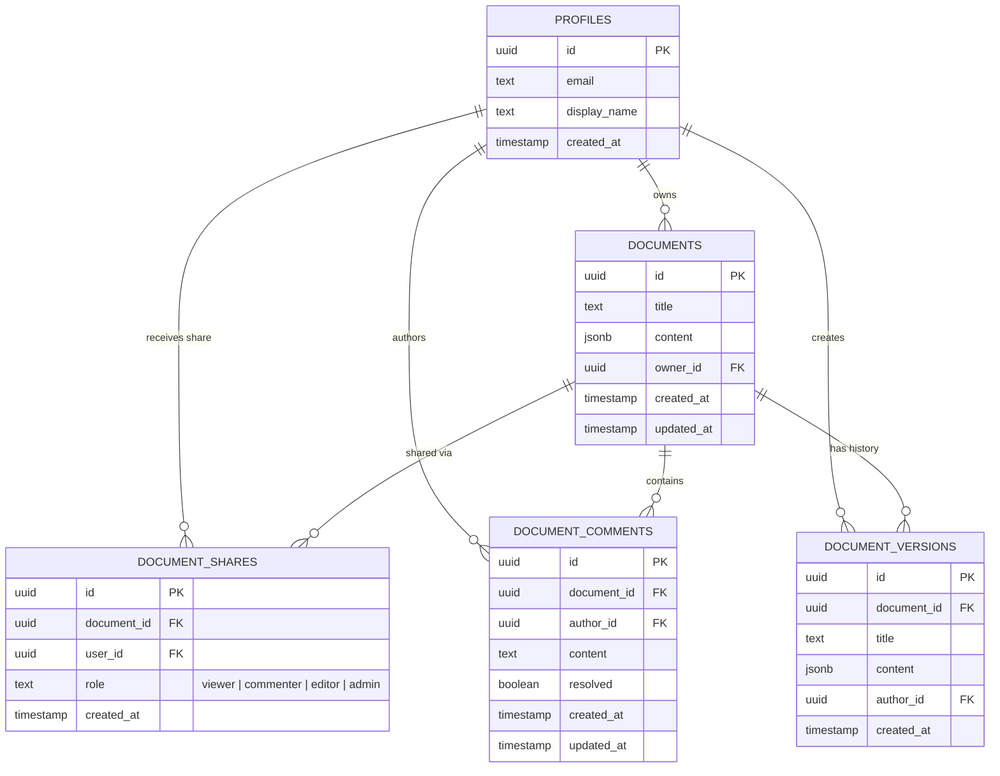

# Architecture and engineering tradeoffs

## 1. Product slice

Ajaia Docs delivers a focused collaborative document workspace designed for modern team productivity:
- **Document Management:** Workspace navigation, ownership vs. shared filtering, title renaming, permanent deletion with confirmation modal.
- **Rich-text Editing:** Powered by TipTap with support for headings (H1–H3), inline styles (bold, italic, underline, strikethrough), code blocks, bullet/numbered lists, blockquotes, and dividers.
- **Real-time Collaboration Indicators:** Live presence avatar stack with colored rings, online status indicators, and pulsating participant counts.
- **Commenting & Suggestions:** Slide-over comments panel with Open/Resolved filtering, thread resolution, comment deletion, and Suggestion mode toggle.
- **Version History & Rollback:** Milestone snapshots tracking author, timestamp, and word count, accompanied by a live content preview and one-click restore.
- **Multi-format Export:** High-fidelity PDF generation via print CSS stylesheets, alongside Markdown (`.md`) and plain text (`.txt`) file downloads.
- **Role-based Permissions:** 4 distinct tiers: **Viewer**, **Commenter**, **Editor**, and **Admin**, backed by database Row Level Security.
- **Zero-config Local Demo Mode:** Complete offline capability with switchable demo profiles, seeded documents, comments, and version snapshots.

---

## 2. Technology stack

- **Next.js 15 (App Router) + React 19 + TypeScript:** Unified full-stack architecture providing typed client components and SSR foundations.
- **TipTap:** Structured JSON abstract syntax tree (AST) for resilient rich-text manipulation and round-trip conversion without unsafe HTML parsing.
- **Supabase Auth & PostgreSQL:** Secure user identity management and durable relational storage.
- **Supabase Realtime:** WebSocket-based Presence channels (`presence:doc:<id>`) for real-time collaborator tracking.
- **PostgreSQL Row Level Security (RLS):** True database-level authorization ensuring users can only read or mutate authorized data.
- **Vanilla CSS Design System:** Glassmorphism, tailored HSL color tokens, dark mode palette, smooth micro-animations, and dedicated `@media print` stylesheets without Tailwind dependencies.
- **Vitest:** Deterministic unit tests covering text conversion, markdown formatting, and validation logic.

---

## 3. Data model

The relational schema is defined in [`supabase/migrations/001_initial_schema.sql`](./supabase/migrations/001_initial_schema.sql):

### Table Details:
1. `profiles`: Automatically created via trigger upon Supabase Auth signup.
2. `documents`: Stores document title, JSONB TipTap AST content, and `owner_id`.
3. `document_shares`: Associates documents with collaborator user IDs. Enforces `role IN ('viewer', 'commenter', 'editor', 'admin')`.
4. `document_comments`: Threaded comments attached to documents, containing resolution state and timestamps.
5. `document_versions`: Historical snapshots capturing title and JSONB content at specific milestones.

---

## 4. Authorization & security boundary

Security is enforced at the database layer via PostgreSQL Row Level Security (RLS), not solely on the client:

- **Read Access:** A user can read a document, its comments, and its versions if they are the owner or hold an active share (`viewer`, `commenter`, `editor`, or `admin`).
- **Comment Access:** Governed by `can_comment_document(doc_id)`. Permitted for owners, admins, editors, and commenters. Viewers cannot insert or modify comments.
- **Edit Access:** Governed by `can_edit_document(doc_id)`. Permitted only for owners, admins, and editors. Viewers and commenters are restricted.
- **Admin/Management Access:** Governed by `can_manage_document(doc_id)`. Permitted only for owners and admins. Allows sharing by email, altering collaborator roles, and revoking access.
- **Document Deletion:** Restricted strictly to the document owner.
- **Account Deletion:** Executed via `delete_user_account()` RPC (`SECURITY DEFINER` with empty `search_path`), cascading across user documents, shares, and auth records.

---

## 5. Real-time collaboration presence

Rather than coupling the editor to complex CRDT synchronization, real-time collaboration is structured around Supabase Realtime Presence:
1. Each open document connects to channel `presence:doc:<id>`.
2. Clients track active participants: user ID, display name, email, color assignment, and active role.
3. Participants receive live updates on join/leave, updating the topbar avatar stack and active count badge (`2 active`).
4. In offline/demo mode, a mock presence provider simulates active peer presence to verify visual UX without cloud credentials.

---

## 6. Save behavior and version control

- **Canonical Format:** TipTap JSON represents document structure unambiguously.
- **Debounced Autosave:** Edits trigger a 650ms debounced save to Postgres, displaying state badges (`Saving…`, `All changes saved`, `Save failed`).
- **Milestone Version History:** Users can record explicit milestone checkpoints or review automatically captured snapshots. Restoring a version loads its JSON AST into the editor and writes an update to the database.

---

## 7. Export and print architecture

- **Markdown & Text Export:** The client traverses the TipTap AST, transforming headings, lists, bold/italic marks, and blocks into standard Markdown (`.md`) or plain text (`.txt`) for immediate browser download.
- **PDF Export via CSS Print Styles:** Instead of injecting heavy binary PDF generation packages (e.g. `jspdf` or `pdfkit`), the application implements custom `@media print` rules. Triggering `window.print()` produces high-fidelity vector PDFs with page margins, preserving typography while hiding sidebars, topbars, and modals.

---

## 8. Deliberate tradeoffs and future roadmap

| Decision | Rationale | Next Step |
|---|---|---|
| **Last-Write-Wins with Version Rollback vs. CRDTs (Yjs)** | CRDTs introduce significant state machine complexity and WebSocket persistence infrastructure. Debounced autosave + milestone rollback satisfies team collaboration reliably within the timebox. | Integrate `@hocuspocus/provider` or Yjs over Supabase Broadcast for simultaneous character-level co-editing. |
| **Print-based PDF vs. Server-side Puppeteer** | Client-side `@media print` generates instant vector PDFs with zero server CPU overhead or cold-start latency. | Add a headless Chromium API route for automated batch PDF rendering. |
| **Flat Owned/Shared Lists vs. Nested Folders** | Prioritized search, quick filtering, and clear permission boundaries over hierarchical directory management. | Add document tagging and collection workspaces. |
